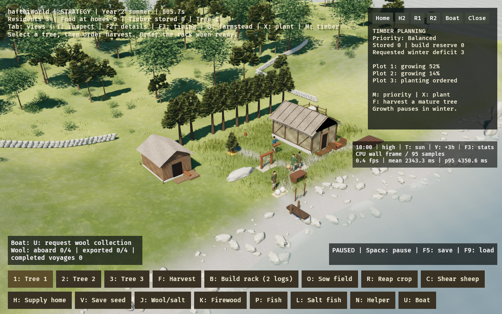

# Forestry and timber planning

This bundle implements two connected steps: managed timber regrowth and player-
selected allocation of real timber between construction and both homes' winter
stocks. The same workers, stocks, trees and growth clocks serve both cameras.

## 1. Plant, grow, harvest again

- Select one of the three timber plots with 1/2/3 or click its tree/stump.
- **F** orders felling of a mature tree. Its two units must be carried to storage.
- After felling, **X** orders replanting. The founder walks to the plot and performs
  four seconds of planting work before a sapling appears.
- Growth takes **two growing seasons** (240 gameplay seconds outside winter).
  Winter pauses growth. A sapling gradually grows in place and cannot be felled.
- Once mature, press **F** for the next crop. Replant again with X afterwards.
  These remain explicit work orders, not an autonomous forestry profession.

A new crop receives new material IDs when the worker fells it. Installed building
wood and burned firewood stay spent: their records are never rewritten into a
standing tree or fresh stock. Even an older save with all initial wood spent can
replant its stumps and earn new timber through growth and work. The same tree
visuals grow again; new log units share the existing mesh/material handles.

Growth timing, planting supply and two-unit yields are deliberately compressed
prototype rules. They do not claim real pine rotation ages, archaeological yields
or a reconstructed Gotland forestry method. No separate seeds/tool-production
chain is added. Hunger/death/worker fatigue remain outside this slice.

## 2. Choose what gets the timber

**M** cycles the timber priority and opens its inspector, which shows shared
stock, outstanding construction cost, requested winter stock deficits and all
three plots' growth states.

| Priority | Behavior |
| --- | --- |
| Balanced (default) | Protect timber still owed to ordered buildings; share remaining fuel through the existing household providers. |
| Building first | Give the founder ready construction work ahead of household supply; protect its unfilled material cost. Other residents may carry genuinely spare fuel. |
| Winter reserves | Protect the requested fuel targets before construction can pick up more stored wood. |

**B** still orders the two-unit rack; **G** orders the two-unit second farmstead.
**K** requests the first household's fuel. Household 2 requests its own supplies
when its resident arrives. Requested winter targets are three units per active
home, minus that home's actual owned wood. They are stock targets, not a forecast
of every future winter. Food/seed orders remain separate from the timber policy.

A change of priority never takes back carried or delivered goods. A worker
rechecks policy and availability before pickup; after pickup, that delivery stays
committed. Assembly can finish once a building's materials have arrived, even
when another priority protects the remaining stock. If protected needs exceed
available timber, the work waits for another harvested crop or a different choice.
No warning or pop-up is required to authorize ordinary orders.

## Persistence and bounds

Planting orders, sapling ages, timber priority, source plot, physical pile slots
and the complete material ledger are saved. Space freezes work and growth; Tab
and T/Y do not change them. Old six-unit JSON inventories migrate naturally to
the expanded log list and receive default forestry metadata and Balanced priority.
No original resident or initial log entity is replaced by a camera switch.

Each unloading allocates a free slot in its destination pile. Picking up another
log does not rearrange the remaining stock. Old installed/burned units remain in
the saved history. New units use dynamically added visuals; loading an earlier
save removes visuals for units that do not exist in that save.

The prototype allows 24 live timber units (including queued new yields) and a
2,048-record material history, with save validation and bounded growth. A full
stockpile blocks additional new-crop orders instead of overflowing storage. The
history limit is a preview bound, not unlimited forestry for an unbounded campaign.
The three managed plots and fixed building locations are unchanged.

## Validation

Tests cover actual cut/haul/build/replant/grow/cut work, unchanged installed and
burned units, winter pause, partitioned updates, selected work under each policy,
in-flight deliveries, stable pile slots and both households heating across years.
Rendering integration checks visible scaled saplings, new shared log visuals,
preservation of original entity IDs and restoration to an older smaller ledger.
Save tests restore growing plots and a new-generation log in actual transit,
retain the chosen priority, accept old snapshots and reject inconsistent metadata.

For a desktop smoke test, fell a tree, order X, inspect its progress with M, save
with F5 and reload with F9. Once mature, fell it again, then order B/G and K and
cycle M to observe which real pickup starts. Test both views. Linux software-
Vulkan capture is functional evidence; native Metal appearance/performance still
need desktop review.

The High Linux capture follows accelerated actual felling, construction,
planting and regrowth. At capture there are twelve material records (the original
six plus another actual crop), two built structures, and three residents. Two
plots are growing at different ages and another has a planting order. The scene
is paused for review. Its software-renderer timings are not native hardware data.
