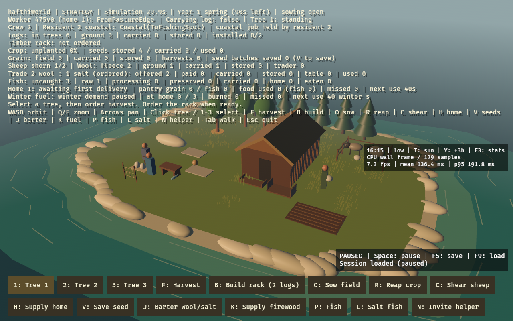
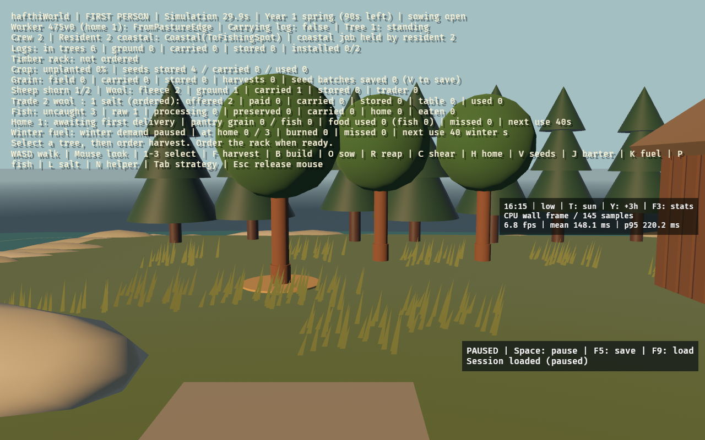

## Save a session and resume ongoing work

Longer settlement sessions can now be kept between launches. Space pauses settlement simulation while camera navigation and queued orders remain available; F5 saves one local slot and F9 restores it paused. A status panel shows pause state and save/load outcomes in either camera mode.

The versioned snapshot retains the complete settlement, both residents' job progress and actual carried items, exclusive coastal ownership, resource locations, orders, calendar, household/fuel timers and sunlight. Restore reuses resident entities by domain ID and reconciles the optional helper/body/children. Camera poses, selected tree and render quality stay current. Session keys require window focus and work with released first-person mouse capture.

The slot is `hafthi-save.json` in the working directory, gitignored. Saving validates cargo and roster and writes and flushes a new sibling temporary file before renaming over the previous slot. Damaged/truncated/unsupported saves report a visible error before changing the running session. The checksum detects accidental damage; manually edited saves and format migrations are unsupported. A stale temporary file reports failure, preserving the previous slot. No autosave or multiple slots.

## Validation

- `cargo fmt --check`, `cargo check --locked`, `cargo clippy --locked -- -D warnings`.
- `cargo test --locked`: **75 passed**. Six new tests compare uninterrupted/restored progression across busy two-resident coastal/material chains; check exact timers/cargo, pause, focus guards, domain/visual roster changes, and file failure/damage/version handling.
- Debug and release builds; graphical Linux software-Vulkan check of save/pause, solo/helper restoration, both camera modes and restore after restarting. Captures in `docs/screenshots/session-*.png`.
- Desktop macOS/Metal remains for user testing; software-renderer timing is not a hardware performance result.

Stacked on #15 (`codex/coastal-helper`). Related to #1; implements a small persistence/usability package, not the remaining roadmap. No new historical claims or external art assets. Adds direct serde/serde_json dependencies already used transitively by Bevy; float round-trip parsing retains simulation timers exactly, with vector serialization scoped to simulation fields.

