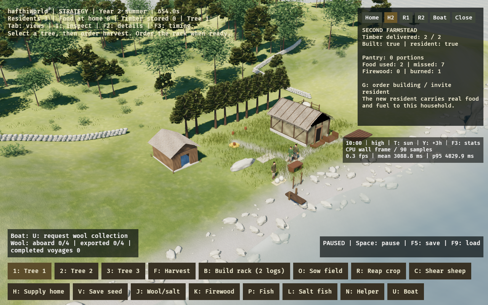

# Second farmstead

This slice expands the persistent simulation to two owned households and up to
three residents. It keeps the same Rust/Bevy world in strategy and first person.
The new home is a fixed, marked plot west of the existing farm at (-11, -4).
Its footprint is reserved from startup, with visible pegs; walking cannot become
trapped inside newly completed walls. The site, stockpile approach and doorway
are shared by workers, collision and inspection.

## Play

1. Begin a new session, or use an existing save with two unspent timber units.
2. Press **G** to order construction. Select trees with 1/2/3 and press **F** to
   fell them; the founder gathers real logs and delivers two stored units to
   the new plot. Do not spend every log on the rack or household firewood first.
3. Foundations, posts and walls appear with construction progress. After both
   units arrive, the founder walks to the door and performs 12 seconds of assembly.
4. Press **G** again when complete to invite the new household's resident.
   **N** remains the separate invitation for the original household's coastal helper.
5. Sow with O, reap with R when ripe, and use the existing coastal production
   chain for salted fish. H and K request food/firewood for home 1. The new
   resident automatically fetches available grain/salted fish and firewood for
   home 2. Reserved seed is protected. Nothing appears in either pantry for free.
6. Click the new house or **H2** in the inspector for its owned stock, consumption
   and shortages. Click its resident for the actual job/cargo. G opens H2 as well.
7. Use Tab, Space, F5 and F9 as before. Loading a pre-expansion save leaves the
   new plot unbuilt and preserves its original population and inventories.

The original founder builds and works the land; the coastal helper retains
coastal work; the newcomer supplies the second household. This is a small authored
allocation, without a general job-assignment screen. Household IDs and resident
IDs are distinct: the newcomer is stable resident 3 even when the helper has not
yet joined. Invitations cannot duplicate residents. Completed construction does
not automatically invite anyone.

## Material and demand contracts

The two construction units become `LogLocation::Homestead` and cannot also heat
a home or build the rack. Six initial timber units are still the complete finite
supply: rack (2), second house (2), and remaining winter fuel must compete. A save
that has spent all timber can inspect/order the site but cannot finish it; this
slice adds neither renewable timber nor free replacement materials.

Pantries and hearths own items by household ID. Each occupied home advances its
own food and winter fuel clock once per world tick, irrespective of how many
workers/cameras observe it. Home 2 demand begins only after its resident arrives.
The original food abstraction is one ration per household interval, not a new
per-person nutrition model. Missing supplies are reported; no death or migration
is implemented. Shared supply selection avoids stockpiling the first home's food
while home 2 waits, and races for a portion recheck availability before pickup.
A pending/coastal worker cannot create a second copy of an already claimed fish.

The next annual coastal round accepts fish actually eaten by either active home,
while still rejecting uneaten or carried items. Save data includes construction,
invitation, owned stock, demand clocks, cargo, worker roster and three residents'
animation state. The new field defaults for older saves. Older binaries cannot
necessarily read these extended saves; keep a backup before moving backwards.

Timber units, timings, fixed layout and architectural detail are gameplay/art
choices, not an archaeological reconstruction or a literal two-log house.
The new house reuses original textured timber and thatch art; no new third-party
asset or dependency is introduced. Interiors remain inaccessible.

## Verification

- Actual tree felling, stock transport, two-unit construction and assembly;
  repeated orders/invitations cannot refund materials or duplicate work.
- Worker and first-person clearance along both approach segments and the door.
- Same three worker entities across repeated camera switches; eight supplied
  food units consumed across two homes, real wood burned by each, no lost cargo.
- Contention for the same fish checked in both pickup orders without panic/duplication.
- Actual harvested grain carried by resident 3, saved/restored alongside the
  construction ledger, roster and its animated pose. Invalid completion is rejected.
- Legacy snapshot loading, input focus/mouse guards and existing roster restoration.

Linux graphical review uses the compiled High renderer and accelerated real
simulation work to reach construction/arrival. A screenshot records the built
farmstead and its inspector. It is functional visual evidence, not a Metal
performance measurement. Native macOS/Metal appearance remains for desktop review.

The review capture precedes the final closed-door/pantry/firewood trim and compact HUD wording;
construction, population and actual consumed household supplies are unchanged.
