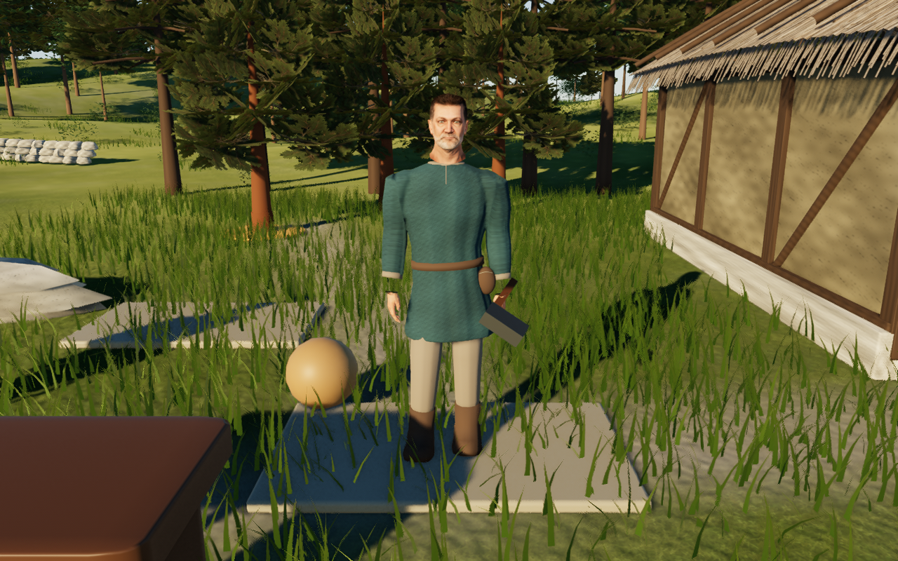
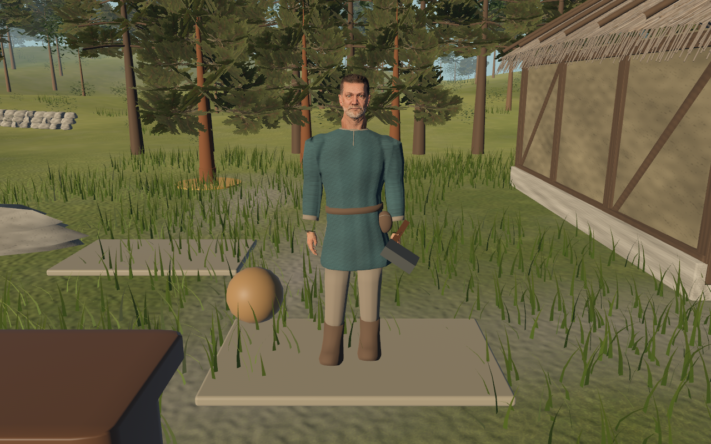
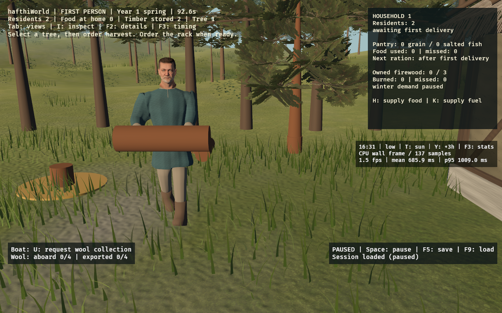
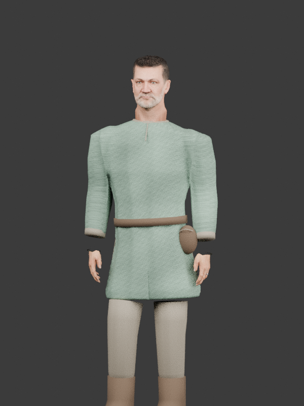
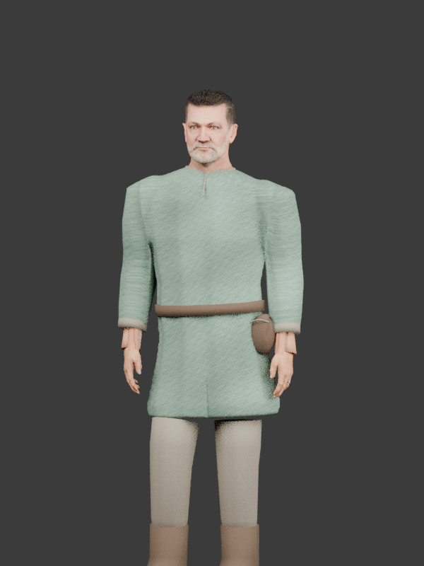

# Textured residents and native animation

The supplied close-up exposed a larger problem than exposure or roughness:
featureless skin, poorly shaped hands, rigid anatomy and primitive movement.
This slice replaces the runtime resident rather than adding another lighting pass.

## Art and provenance

The face, neck, hair cards, bare hands and 80-joint skeleton adapt Microsoft's
**MIT-licensed Rocketbox Male_Adult_05**. The source avatar's modern vest,
trousers, shoes and wrist accessories are excluded. Tunic, linen, belt, boots
and pouch remain project-authored. Garment weights are rebound by clothing
region so a nearby lowered wrist cannot pull the skirt into spikes. Concealed
upper trouser rings are shortened to remain under the tunic during a forward
stride; the transport capture checks the real carried-log walking pose.

The head and hands use embedded 2048px color/normal maps; hair uses the source
alpha map. Skin is matte PBR with a small thin-surface backlight contribution.
**This is not a full subsurface-scattering implementation.** No engine fork or
new Rust dependency is required. Distinct faces, facial animation, cloth
simulation and a production costume library remain future work. All five
people currently share this face; tunic colors and animation phase distinguish
them, not a new population generator.

Pinned source: [Microsoft Rocketbox](https://github.com/microsoft/Microsoft-Rocketbox/tree/0943055db6ec570bcef9f2c8b41c9e5467c808f9).
Exact paths, SHA256 checks and commit are in
[`rocketbox-sources.json`](../tools/art/rocketbox-sources.json).
The full [MIT notice](../assets/licenses/Microsoft-Rocketbox-MIT.md) is included
in the repository **and inside the GLB's copyright metadata**, so it travels in
the standalone executable too. Rocketbox human anatomy/motion is a contemporary
reference, not archaeological evidence for Gotlandic people, clothing or work.
The retained costume and generic work gestures are artistic interpretations.

## Animation and shared simulation

`resident.rs` builds one native Bevy `AnimationGraph` from four named glTF clips:
Idle (breathing), Walk, Work and Table. Rocketbox FBXs share anatomical local
axes but have different bind poses; the authoring script transfers world
rotations while preserving the target avatar's bone lengths. Horizontal root
motion is removed, vertical body motion retained, and the walk clip is paced
against the existing 1.2 m/s worker movement. A short end seam closes the loops.

Each actual worker has an independent `AnimationPlayer`. Task changes crossfade
over 0.28 simulation seconds; heading follows the shortest angular path.
Clips are paused in Bevy and explicitly sought from `SimulationClock`, so render
updates cannot advance a paused game. The two visiting sailors and trader only
breathe; they do not acquire worker roles, needs, orders or resources.

After native animation evaluation and before transform propagation, analytic
two-bone IK adjusts stance feet to the shared terrain height and reaches towards
the actual carried cargo positions. Swing feet fade out of contact correction.
Solves preserve limb lengths and clamp unreachable targets; hand orientation
stays with the clip. This is contact correction, **not** navigation, finger grasp
animation, obstacle avoidance or guaranteed collision-free cloth. Existing
work/economy rules and pathfinding are unchanged. Cargo is still the same real
inventory mesh and the axe follows a hand socket.

Version-one save payloads gain an optional `resident_motion` field holding the
blend source, target, heading and transition times. F9 restores it along with
the simulation clock, preserving a mid-transition pose. Older payloads without
this field load with default motion state. Older game binaries that reject
unknown fields cannot read the newly extended payload; use the current build.

## Authoring and checks

Runtime and cargo builds need no Blender, Python packages, downloads or external
asset directory. The checked-in GLB and motion metadata are embedded.

To reproduce from the repository root (Python + NumPy; Blender 4.3.2):

```sh
python3 tools/art/fetch_rocketbox.py /tmp/hafthi-rocketbox
HAFTHI_ROCKETBOX_SOURCE=/tmp/hafthi-rocketbox blender --background --python-exit-code 1 --python tools/art/build_textured_resident.py
python3 tools/art/verify_textured_resident.py
```

For fish, replace the environment assignment on the Blender command with
`env HAFTHI_ROCKETBOX_SOURCE=/tmp/hafthi-rocketbox blender ...`.
The builder also reads the checked-in `coastal-resident.blend` as a costume
donor. `textured-resident.blend` is the editable output with packed textures
and four baked actions. `build_resident.py` remains the old donor workflow,
not the runtime character exporter.

The independent GLB validator checks embedded textures/license, 80 joints,
normalized normals/skin weights, four clips, sampled skin bounds, no horizontal
root travel, and lowered idle wrists (the rest-frame conversion regression).
Rust tests cover clock-driven native-player weights/seeking, pause and restoring
mid-blend, old snapshot payloads and two-bone length/reach constraints, alongside
the existing economy/save suite. These checks do not establish visual quality.

Desktop review:

```sh
cargo run --release --locked -- --quality high
```

Inspect the founder at walking distance with Tab. Order 1/F, then C/J/P/L and N
to see walking, work and cargo with two independent workers. Space should freeze
all body motion. F5, resume, F9 should return the exact task/cargo/heading and
blend paused; Tab should show the same people. Repeat with `--quality low`.
High and Low currently share character geometry/textures. The new export has
18,115 vertices versus the old donor's 61,117, but adds skin textures and native
animation work. The embedded GLB grows from about 4.7 to 32 MiB; this is
**not a measured performance improvement**. Cloud
software-Vulkan checks do not measure native Apple Metal performance.

## Actual game captures

High and Low below are uncropped 1280×800 screenshots of the running game,
with F4 hiding the HUD. They use different paused clock/solar states and are
functional character reviews, not a matched lighting/performance comparison.





A separate uncropped Low capture follows a real tree harvest/log pickup, then
F5/resume/F9. It shows the same paused walking/cargo pose at 92.625 simulation
seconds after the concealed trouser trim. The cloud GUI check also re-saved a
two-worker walking/fishing snapshot after F9 and compared its full payload:
simulation, cargo, headings and blend state were identical.



## Neck and collar fit

The source head's lower rim followed its original modern shirt: the rear edge
ended about 5 cm above the project collar. The existing anatomical neck surface
now continues 7.5 cm below its former lowest edge, inside the tunic, with its
base weighted to Spine2. Upper garment weights blend from Spine1 to Spine2 so
the collar follows the same upper chest during bends and turns. Head position,
height, facial geometry, animation timings and save data are unchanged.

The independent GLB check ray-tests every lower neck rim vertex against the
actual skinned tunic, requiring it to remain inside.
It covers rest pose, 36 clip poses and 18 crossfades; the prior asset fails this
regression check. Front game captures have been refreshed after the correction.

## Proportion correction

The long exposed neck is shortened by lowering the skull, eyes, hair and all
head-descendant rest joints together by 4 cm. Facial geometry and UVs retain
their original scale. The existing continuous neck rim remains tucked inside
the tunic and is checked in animated poses. The finished character is 1.66 m
rather than 1.70 m; the shoulders, hands, feet and cargo sockets retain their
positions. The tunic and belt gain a small, smoothly tapered amount of fullness
at the waist, preserving the existing sleeve/cuff fit and garment topology.

This is a proportion adjustment to the existing shared male model, not new
character variants or finished clothing art. The Blender studio portraits below
compare the same Idle frame, camera and lights; they are asset review renders,
not screenshots from Metal or performance measurements.




## Connected hands and sleeves

Removing the modern source cuffs/watch also removed the anatomical wrist
connection. Each hand now continues as a single skin surface through four
weighted rings into the sleeve. Weights blend from hand to forearm; the
proximal ring follows the forearm and stays buried inside the existing sleeve.
The extension samples adjacent bare-palm texels rather than stretching the
source wristwatch into a dark band. Fingers, skeleton, sockets and clip timing
are retained. The mesh gains only 208 vertices before glTF UV splits.

The independent GLB validator requires both continuous proximal wrist rims and
ray-tests their containment inside the actual deformed tunic at rest, in 36
animation poses and 18 crossfade samples. The previous asset fails this check.
The matched studio portraits show the geometry/material change, not a native
Metal gameplay or performance test.



